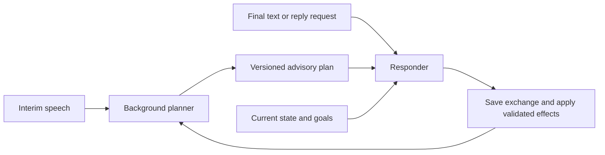

# Activity pipeline refactor plan

Recorded on November 5, 2026. The previous planning response is reproduced verbatim below. Later clarifications and progress are recorded separately after it.

---

**I would keep the existing harness architecture and refactor the activity pipeline underneath it in stages.** Your ideas are feasible, but they involve three different systems: live conversation control, background memory processing, and activity authoring. Giving each a clear contract will make them easier to build and evaluate.

I reviewed the current implementation and your [sample activity instructions](/Users/adnansadi/GitHub/TG-Data-Preprocess/memory_activity.json). No files were changed.

One distinction will help throughout: keep **harness** for the Python component that runs a chat type; call the generated task definitions **state specifications**, and call tone/persona settings **behavior policies**. Those serve different purposes, even when the same activity uses all three.

I would approach the refactor in this order:

| Stage | Main change | Completion criterion |
|---|---|---|
| 1 | Stabilize activity state and closing | Cancelled replies cannot advance the activity |
| 2 | Introduce structured goals and plans | You can inspect why a goal is complete or a transition occurred |
| 3 | Separate planning from responding; add scheduling | Responses proceed without waiting for a planner |
| 4 | Add reusable, versioned activity definitions | Multiple activities can share states without sharing progress |
| 5 | Add the state-specification creator and admin viewer | Instruction edits produce validated, traceable definitions |
| 6 | Add persistent user memories and migrate embeddings | Memories survive retries and retrieve correctly per participant |
| 7 | Add activity switching | A session can change activities while retaining its context |

Memory work can proceed alongside stages 4–5 once reliable background jobs exist.

**1. Make the existing activity state safe before introducing background planning.**

Currently, the planner modifies `rag_state` before response generation and persistence. Introducing interim planning on top of that would allow incomplete speech to change the authoritative conversation state.

The first refactor should establish this rule:

> Agents propose changes. The runtime validates and applies them at defined boundaries.

The existing `ResponseOutcome.state` and `on_reply_saved()` mechanism already provide a useful foundation. Move activity generation toward returning a proposed next state instead of mutating the current one.

Also make the timing explicit: does a transition happen before this reply, after this reply, or after the user answers it? Today, the pipeline loads the current state’s instructions, allows the planner to select another state, and then generates using the original instructions plus the planner’s guidance. That leaves the responder with potentially conflicting directions.

There are three immediate fixes worth including:

- The closing-handler state-access bug discussed earlier.
- The unconditional advancement after three turns. Your sample sometimes calls for three to five turns, and required goals may still be incomplete.
- Conflicting closing behavior: your `end_conversation` specification says goodbye and prohibits new questions, while the subsequent closing handler offers a summary and invites further questions.

These changes belong primarily in [the activity pipeline](/Users/adnansadi/GitHub/v2_benchmarking/backend/chat_app/websocket/services/ragChatHelpersMultiAgent.py:369), [ActivityHarness](/Users/adnansadi/GitHub/v2_benchmarking/backend/chat_app/websocket/harnesses/activity/harness.py:44), and the closing handler.

**2. Replace vague guidance with explicit goals, evidence, and response plans.**

Your concern about skipped sub-goals is well founded. A prose instruction such as “acknowledge the user, ask about interests, and transition naturally” leaves several independent decisions implicit.

Separate three kinds of requirement:

| Requirement | Example | Evidence needed |
|---|---|---|
| Assistant obligation | Present all three memory-topic options | The assistant response contains those options |
| User-dependent goal | User selects a memory topic | A finalized user statement identifies a choice |
| Repeated response rule | Address a direct question before asking another | Checked for each applicable turn |

This distinction matters because “asked a question” and “received an answer” are different achievements. Likewise, acknowledging the user is usually a recurring obligation rather than a state goal completed once forever.

For your `initiate_memory_activity` state, a specification could conceptually contain:

```json
{
  "state_key": "memory.offer_topics",
  "response_rules": [
    "acknowledge_latest_contribution",
    "keep_invitation_optional"
  ],
  "goals": [
    {
      "id": "present_topic_options",
      "actor": "assistant",
      "required": true,
      "options": ["cars", "early_communication", "moon_landing"]
    },
    {
      "id": "select_topic",
      "actor": "user",
      "required": true
    }
  ],
  "transitions": [
    {
      "target": "memory.discuss_topic",
      "requires": ["present_topic_options", "select_topic"]
    }
  ]
}
```

That is an illustrative shape; the exact schema should follow a small working prototype.

Track progress separately from the definition: goal ID, status, supporting message IDs, and any skip reason. Useful statuses include pending, satisfied, declined, and skipped. A user who declines an activity should have an explicit exit path.

Some checks can be deterministic. For example, render the three topic choices from structured data so none can be omitted. Other checks, such as whether an acknowledgment appropriately reflects an emotion, still need model judgment. Require evidence and evaluate those judgments; a structured checkbox alone does not establish correctness.

For the planner-to-responder handoff, replace the single guidance string with compact fields such as:

- Current state and targeted goal IDs.
- Specific user fact to acknowledge.
- Direct question to answer.
- Information or options to include.
- One suggested follow-up.
- Previously covered material to avoid repeating.
- Proposed transition and supporting evidence.

For a small model, render these into short, concrete instructions. The responder should receive the current state’s relevant requirements and a few useful facts, rather than the entire activity specification.

**3. Move the planner off the response path, then add interim planning.**

Your proposed background observer is feasible. The inputs you mean here are **interim STT transcripts**. The existing harness hooks already receive these events.

I would implement this in two milestones: asynchronous planning from finalized turns first, followed by speculative planning from interims.



At response time, the runtime captures the newest **compatible completed plan**. If none exists, the responder uses the current state specification and final user text immediately. A planner call should not become a prerequisite for responding again.

Compatibility needs more than a timestamp. A plan should identify its activity run, definition version, state version, and transcript revision. A plan based on “I like football…” must be discarded or qualified if the user continues “…but I don’t follow it anymore.”

For interims:

- Keep one latest observation per session, replacing older observations.
- Debounce meaningful transcript changes and limit planner launch frequency.
- Avoid accumulating a queue of every interim transcript.
- Treat interim conclusions as provisional.
- Reconcile them against finalized speech before accepting goal completion or transitions.

Your response-priority requirement needs control at two levels:

| Level | What it can do |
|---|---|
| Application scheduler | Prioritize waiting responses; defer or discard speculative work |
| Inference server | Control requests already executing and competing for model capacity |

**A priority queue cannot by itself pause a running model request.** Cancelling an asyncio task or HTTP request also does not establish that the server stopped inference. For IU, verify whether the gateway supports request priorities and cancellation, and whether those reach the serving engine.

I would use these workload classes: live responses first, speculative planning second, and offline extraction/compilation last. Stop admitting background work when responses are waiting, and keep background requests short and bounded. If stronger latency isolation is needed, reserve serving capacity or run the planner on a separate deployment.

An `asyncio.PriorityQueue` is reasonable for a single-process prototype. Multiple Django workers require coordination through a shared dispatcher or serving-layer scheduler. Also preserve fairness among participants: one session should not monopolize response capacity.

**4. Separate reusable definitions from activity membership and runtime progress.**

Your state-reuse idea is good, but shared state names should not imply shared completion.

The current [`RAGInstructions` model](/Users/adnansadi/GitHub/v2_benchmarking/backend/chat_app/models.py:469) combines the state definition, activity membership, and ordering. I would gradually separate these concepts:

| Concept | Purpose |
|---|---|
| State template and revision | Reusable definition such as `rapport.smalltalk` |
| Activity version | A particular published activity configuration |
| Activity-state binding | Which state revision an activity uses, with local settings |
| Transition | Allowed movement between states |
| Activity run | One execution within a chat session |
| State visit and goal progress | What happened during that execution |

Use stable identifiers rather than interpreting display names. Your sample already demonstrates the value: it references `comparing_past_with_present`, but defines `connecting_past_with_present`.

Pin versions for running conversations. Editing a shared state should create a revision that activities can adopt deliberately; it should not silently change a session halfway through.

For introductions, use entry conditions and session/profile information. Your app already stores participant names. A greeting state can ask for a preferred name only when needed, and an activity started midway through a session can enter after the introduction.

The admin/API needs attention too: [instruction creation currently hardcodes `memory_activity`](/Users/adnansadi/GitHub/v2_benchmarking/backend/chat_app/api/views.py:148). That must become an explicit selection or binding before the UI can manage several activities properly.

**5. Build the state-specification creator after proving the runtime manually.**

I would first hand-author a structured version of a few memory-activity states. That lets you validate what the interpreter needs before asking an LLM to produce it.

Then implement your creator as an authoring agent that generates **declarative JSON consumed by trusted Python code**. Its output can describe goals, evidence requirements, response constraints, and allowed transitions.

The editing flow should be:

> Save instruction revision → enqueue compilation → generate specification → validate → save matching revision → publish according to admin policy.

Validation should check referenced states, required fields, allowed actions, and incompatible requirements. Instruction text should be treated as source material; it cannot override the compiler’s output schema or validation rules.

Keep source and compiled versions together. A slow job for revision 3 must never overwrite a completed revision 4. The admin should show the original instructions, generated goals/transitions, validation errors, and revision history.

Use one shared write service for regeneration, since instructions can be edited through multiple API/admin paths. A callback on just the current frontend endpoint would miss other edits.

This work also needs durable background jobs. Your current `fire_and_log()` helper supervises process-local tasks, but those tasks do not survive worker restarts. Compilation and memory extraction need persisted status, retries, and idempotent processing.

**6. Add user memories as canonical records with embeddings as a derived index.**

The existing vector store contains **activity instruction chunks**, not participant memories. Also, the current multi-agent activity reads exact instructions from the main database. Therefore, improving planning does not depend on replacing MiniLM.

For conversational memory, separate:

- **Profile facts:** preferred name or other established attributes.
- **Preferences:** enjoys discussing football.
- **Episodic events:** planned to attend a Bears game on a particular date.
- **Session summaries:** broader context from a completed chat.

Keep `kind` separate from topic category. For example, a record can have `kind="episodic_event"` and `category="sports"`; another can have `kind="summary"`.

A useful initial category list is sports, hobbies, family/relationships, work/education, food, travel/places, technology, daily life, personal history, and other. Support multiple categories when appropriate.

Each memory should retain participant ownership, source session/message IDs, observation time, optional event date, and status. “I’m going to the Bears game today” should remain a planned event, with “today” resolved using the session’s local date. It does not establish confirmed attendance or a permanent preference.

Your modality idea is useful. Distinguish **source modality** from **stored representation**: a spoken statement may have `source_modality="audio"` while the extracted memory has `content_modality="text"`.

Reuse the transcript and summary from [existing post-chat analysis](/Users/adnansadi/GitHub/v2_benchmarking/backend/chat_app/services/db_services.py:77). Start memory extraction as a separate typed operation so it can be evaluated independently. Process it after the transcript is finalized, with retries that upsert records rather than duplicate them.

Store canonical memories in the main database. Your vector database is separate, so use stable memory IDs and a reliable projection/reconciliation process. Retrieval should filter participant ownership and record status before similarity ranking, then apply relevant time/category filters.

For embeddings, verify the exact IU model ID. The original **EmbeddingGemma** is text-only; **EmbeddingGemma 2** supports text, image, audio, and video in a shared embedding space. Model support does not establish that IU exposes every modality. [Original model card](https://ai.google.dev/gemma/docs/embeddinggemma/model_card), [EmbeddingGemma 2 model card](https://ai.google.dev/gemma/docs/embeddinggemma/model_card_2?hl=en).

Migrate alongside the old index: add a provider interface, identify the embedding space by model/version/dimensions/formatting, backfill from original text, evaluate retrieval, and then switch reads. MiniLM and Gemma vectors must remain in separate spaces even if you choose matching dimensions.

**7. Add activity switching through a session-level coordinator.**

When the user requests a game or accepts an offer, record a proposed activity switch. Apply it at a controlled turn boundary:

1. Suspend or finish the current activity run.
2. Cancel its outstanding planning work and invalidate late results.
3. Start the target activity at an eligible entry state.
4. Preserve session context, known identity, and relevant memories.
5. Record the handoff for analytics and possible resumption.

Use separate `ActivityRun` records under `ChatSession`; one session-level `chat_type` string cannot describe several activities accurately.

Keep specialized implementations such as the map task. Its geometry and movement rules belong in code. A generic conversational-activity harness can interpret the generated specifications for more open-ended activities.

For behavioral variation, compose policies with explicit precedence: product rules, session/persona preferences, activity policy, state guidance, and agent-role output requirements. The planner might produce concise structured observations while the responder speaks warmly. Each role can use a different model, but roles can initially share one model deployment.

I would make the **first implementation milestone** deliberately narrow: fix state commits and closing, manually structure two or three memory states, and introduce a typed planner result. Then compare response-only, current sequential planning, and asynchronous planning using recorded conversations. Measure goal completion, repeated questions, invalid transitions, model cost, and time to first audible response under concurrent load. Those results will tell you where additional agents improve the system.

---

## Subsequent clarifications

- The live database no longer contains `end_conversation`; the supplied JSON is historical sample material. Keep the current controlled closing workflow. The earlier closing-conflict observation concerns that sample, not the live database.
- The three-turn advancement rule was intentionally added to prevent stalled states. Replace it with explicit saved-turn counters and configurable per-state limits, preserving a bounded escape path and recording skipped goals honestly.
- Code changes are provided in chat for the user to apply. Existing README/documentation edits require the user's approval before application.
- Stages 1–2 retain sequential planner/responder calls. Scheduling and speculative interim planning belong to Stage 3.

## Progress

- [x] Preserve the original planning response.
- [x] Record the user's closing-flow and turn-limit clarifications.
- [x] User applied the initial Stage 1–2 code for review.
- [ ] Stage 1: Apply code changes and verify cancellation and closing.
- [ ] Stage 2: Apply structured goals, evidence, plans, and per-state limits; verify behavior.
- [ ] Stage 3: Scheduling and asynchronous/speculative planning.
- [ ] Stage 4: Reusable/versioned database definitions.
- [ ] Stage 5: Creator and admin workflow.
- [ ] Stage 6: User memories and embedding migration.
- [ ] Stage 7: Activity switching.

These boxes record completed work, not proposed work. Stages 1–2 remain unchecked until the code is applied and verified.

## Implementation review: November 5, 2026

Documentation updates were approved and applied. The activity README now records
temporary testing choices, future improvements, and Docker test commands.

The installed code has two unresolved integration blockers: agents were moved to
`websocket/agents/` without updating the harness's relative imports, and the
planner schema omits `updated_memory` while the pipeline still requires it on
successful turns. Code fixes are supplied in chat for manual application.

All twelve reviewed Python files parsed. Six isolated goal/transition tests passed
using the actual runtime source; a focused execution reproduced the successful-
response `KeyError` caused by the schema mismatch. The complete Django suite has
not run because host dependencies are missing and the Docker daemon is stopped.
Stages 1–2 therefore remain open. The original planning response above is unchanged.

## Follow-up implementation and test results

The user corrected the shared agent imports, restored `ResponsePlan.updated_memory`,
renamed its model to `PlannerMemory`, and consistently uses `planner_memory` for
session state. The retired RAG helpers and legacy consumer were removed. The two
integration blockers identified in the earlier review are resolved in source.

The Docker test run progressed to test-database creation, then failed before any
test cases executed. The primary error was `chat_app_profile.language does not
exist`; the final invalid-cursor error followed that failed SQL query. `Profile`
defines `language`, while the available migration history does not add it. The
session fields `chat_type`, `condition`, and `variant` also have no migration in
that history. Generate and inspect migrations for the current models before
rerunning the suite. The root `.gitignore` excludes chat-app migrations, so they
are not automatically included in version control. No migration files or databases
were modified during this documentation review.

The user requested that numbered implementation stages and planning live only in
this document. Runtime READMEs now describe current behavior, provisional settings,
limitations, and test commands. Historical blocker notes were removed from those
READMEs. This document retains the original plan and historical review entries.

### Role-based naming

Use purpose-based names (`PlannerAgent`, `PlannerMemory`, `ResponseAgent`) rather
than numerical agent identifiers. `planner_memory` is already updated in the
pipeline and failure assertion. Remaining numerical log keys in `pipeline.py` and
one assertion in `test_activity_pipeline.py` require manual replacement:

| Current key/prefix | Replacement |
|---|---|
| `agent2_planner_error` | `planner_error` |
| `agent2_planner_output` | `planner_output` |
| `agent2_planner_latency_ms` | `planner_latency_ms` |
| `agent1_response_latency_ms` | `responder_latency_ms` |
| `agent1_response_error` | `responder_error` |
| `agent1_response` token-usage prefix | `responder` |
| `agent2_planner` token-usage prefix | `planner` |

These changes affect keys in new `agents_data` JSON records, not database columns.
Historical logs retain their earlier key names unless explicitly migrated. The
Python replacements are supplied in chat; only documentation was edited here.

### Verification and improvement backlog

- [x] Align shared agent imports and restore the planner-memory output contract.
- [x] Remove implementation-stage wording from runtime READMEs.
- [ ] Generate and inspect migrations matching the current model definitions.
- [ ] Complete role-based metric-key renaming and update the affected assertion.
- [ ] Run the full focused Docker suite after schema setup succeeds.
- [ ] Add successful planner/responder coverage using the actual `ResponsePlan`
  schema; failure-only pipeline tests do not verify that contract.
- [ ] Add actual closing-branch tests, commit/generation cancellation coverage,
  and a saved-closing-response/TTS-interruption case.
- [ ] Define target-state entry requirements and deliberate timeout/refusal
  routes; decide whether service-error clarifications consume turn budgets.
- [ ] Evaluate optional/conditional goals, recurring obligations, correction
  handling, complete topic-option presentation, and semantic evidence quality.
- [ ] Measure goal fulfillment, repetition, invalid/forced transitions, token
  cost, and final-transcript-to-first-audio latency under concurrent load.
- [ ] Implement Stage 3 scheduling and coalesced asynchronous planning with
  transcript/activity revisions and verified IU serving/cancellation behavior.
- [ ] Implement the later roadmap's reusable/versioned database contracts,
  run/visit persistence, authoring/admin workflow, durable background work,
  persistent memories, and activity switching.

Stages 1–2 remain incomplete until the focused suite and conversation verification
succeed; reaching migration setup does not establish a pass or failure of the
activity test assertions.
